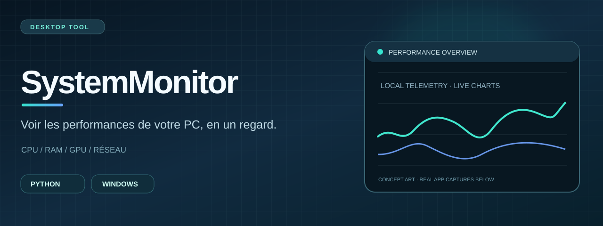

<div align="center">



# SystemMonitor

**Un moniteur système Windows en temps réel pour visualiser CPU, RAM, GPU, disque et trafic réseau.**

CPU · Mémoire · Disques · Réseau · Capteurs matériels


[](LICENSE)

[Fonctionnalités](#fonctionnalités) · [Installation](#installation) · [Captures](#captures-décran) · [Limites connues](#limites-connues)

</div>

---

| ⚡ Performances | 📉 Courbes en temps réel | 🌡️ Capteurs matériels |
| :--- | :--- | :--- |
| CPU, mémoire, disque et débit réseau. | Graphiques PyQtGraph et indicateurs de charge. | Températures CPU/GPU si OpenHardwareMonitor est accessible. |

SystemMonitor affiche l'utilisation du processeur, de la mémoire, du disque et du réseau dans une interface **PyQt5 / PyQtGraph**. Les températures et la charge GPU peuvent être récupérées via **OpenHardwareMonitor**, lorsque les capteurs sont disponibles.

## Fonctionnalités

- 🖥 **Surveillance CPU, RAM, Disque et Réseau**  
  - Affichage en temps réel de l'utilisation CPU, RAM et disque.  
  - Mesure des vitesses d'envoi et de réception réseau (Ko/s).  
  - Indicateurs colorés pour alerter en cas d'utilisation excessive.  

- 🌡 **Température et Utilisation du CPU & GPU**  
  - Récupération de la température du processeur et du GPU via **OpenHardwareMonitor**.  
  - Affichage de l'utilisation en pourcentage du GPU.  

- 📶 **Informations Réseau**  
  - Affichage de l'IP locale et de l'IP publique de l'ordinateur.  

- 📊 **Interface Graphique Interactive avec Graphiques Dynamiques**  
  - Suivi visuel en temps réel des performances du système.  
  - Graphiques interactifs pour CPU, RAM, disque, réseau et GPU.  
  - Bouton permettant d'afficher ou masquer les graphiques.  

- 🎨 **Thème Personnalisable**  
  - Interface moderne avec un thème "Azure".  

- **Collecte des données système** : utilisation de `psutil` ; accès aux capteurs Windows via WMI et OpenHardwareMonitor.

## Installation

### Prérequis

Sous **Windows**, installez Python 3.8+ puis les dépendances suivantes :

```sh
pip install psutil pyqt5 pyqtgraph requests wmi
```

### Cloner le dépôt

```sh
git clone https://github.com/neosoda/SystemMonitor.git
cd SystemMonitor
```

### Démarrer

Sous **Windows** :
```sh
python dashboard.py
```

L'exécution native sous Linux n'est **pas garantie** dans l'état actuel du code (import WMI et appels à des API Windows).

## Capteurs et OpenHardwareMonitor

L'application utilise **[OpenHardwareMonitor](https://openhardwaremonitor.org/)** pour récupérer la température CPU/GPU sous Windows. Assurez-vous que **OpenHardwareMonitor.exe** est dans le même dossier que le script ou modifiez le chemin dans `get_openhardwaremonitor_path()`.

## Captures d'écran

Ces images montrent l’interface réelle du projet ; la bannière en tête de page est une illustration de présentation.


## Limites connues

- Le démarrage d'OpenHardwareMonitor et la collecte WMI utilisent actuellement des API propres à Windows.
- Les températures CPU/GPU dépendent des capteurs disponibles ; une valeur `N/A` ne signifie pas nécessairement une panne.
- Le chemin d'OpenHardwareMonitor peut nécessiter une adaptation, notamment pour un exécutable packagé.

## Questions fréquentes

**SystemMonitor fonctionne-t-il sans connexion Internet ?** La surveillance locale repose sur `psutil` ; seule la récupération facultative de l'adresse IP publique utilise un service en ligne.

**Peut-on surveiller la température CPU et GPU sous Windows ?** Oui, si OpenHardwareMonitor fonctionne et expose les capteurs via WMI ; sinon certains indicateurs affichent `N/A`.

**Existe-t-il une version exécutable prête à télécharger ?** Ce dépôt documente l'exécution du script Python. Aucune version EXE n'est annoncée ici tant qu'elle n'est pas publiée.

## Auteur

Développé par [neosoda](https://github.com/neosoda).

## Licence

Ce projet est sous licence **MIT** – vous pouvez l'utiliser librement.
